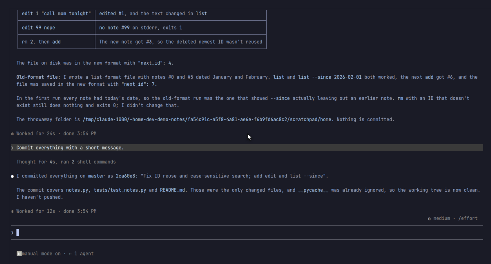

# ccpopout

Read a Claude Code session one message at a time.

Long sessions bury Claude's answers between diffs and command output. ccpopout
pops the session out of the transcript into a view of its own: pick one of your
messages and see what Claude did since, with every tool call folded to one line
until you open it.



It comes in two forms that behave the same:

- **In-app pane** (`/popout`): a pane inside Claude Code.
- **Side pane** (`/popout side`): a separate terminal program in a
  herdr, tmux or Herdr Desktop pane next to Claude Code, at full height,
  following the session live.

## Requirements

- Claude Code with plugin hooks modules. Developed and tested on 2.1.289; the
  API it uses is new and may change between releases.
- For the side pane: Node.js 20 or newer on `PATH`, and Claude Code running
  inside herdr, tmux or Herdr Desktop (herdr-core, `hc`). Without one of
  them `/popout side` opens the in-app pane instead.
- Mouse support in the in-app pane needs Claude Code's fullscreen layout.

## Install

From inside Claude Code:

```
/plugin marketplace add EmreErdogan/ccpopout
/plugin install ccpopout@ccpopout
```

Or from a shell:

```sh
claude plugin marketplace add EmreErdogan/ccpopout
claude plugin install ccpopout@ccpopout
```

If a session that was already open answers `Unknown command: /popout`, run
`/reload-plugins` there, or start a new session.

### Update

From inside Claude Code, refresh the marketplace and then update the plugin
from the `/plugin` menu:

```
/plugin marketplace update ccpopout
```

Or from a shell:

```sh
claude plugin marketplace update ccpopout
claude plugin update ccpopout@ccpopout
```

If an open session still shows the old version, run `/reload-plugins` there,
or start a new session.

The help (`h`) names the version a session runs, in its first row:
`ccpopout 0.9.1 · Keys · …`.

## Commands

| Command | What it does |
| --- | --- |
| `/popout` | Opens the in-app pane on your newest message. |
| `/popout side` | Opens the side pane in herdr, tmux or [Herdr Desktop](#herdr-desktop). Beside Claude Code when the terminal is at least 140 columns wide (on the right, unless [set](#side-pane-side) otherwise), otherwise zoomed over it. |
| `/popout left`, `/popout right` | Opens the side pane on that side of Claude Code, whatever the setting. |
| `/popout close` | Closes the side pane. |
| `/popout keys add` | Adds keys for ccpopout to your key bindings ([more](#key-bindings)). `/popout keys remove` takes them out; `/popout keys` shows which keys. |
| `/popout-side`, `/popout-left`, `/popout-right` | The same as `/popout side`, `left` and `right`, as commands of their own so a key can be bound to them. |

### Side pane side

`/popout side` and `/popout-side` open the side pane on the right of Claude
Code. To have them open it on the left, set the plugin's `side` option to
`left`: in `/config`, or in `~/.claude/settings.json`:

```json
{
  "pluginConfigs": {
    "ccpopout@ccpopout": { "options": { "side": "left" } }
  }
}
```

The environment variable `CCPOPOUT_SIDE=left` (or `right`) does the same, and
wins over the setting.

### Herdr Desktop

In a terminal Herdr Desktop opened (`HC_TERMINAL_ID` set, `HERDR_ENV` not),
`/popout side` starts the popout program with herdr-core:
`hc run --bg --no-notify` with the space and tab labels of Claude Code's
terminal. Desktop adds it to the same tab, on the right at half the width.
Desktop decides where the pane goes, so:

- It opens on the right. On the left (`/popout left`, or the `left` setting)
  it needs the ccpopout mod in Desktop, below; without it, the pane stays on
  the right and the plugin says so.
- The focus goes to the new pane, as in herdr, with the mod; without it, the
  focus stays on Claude Code.
- It is never zoomed: however narrow the terminal, it opens beside Claude
  Code at half the width.
- With the side pane already open, `/popout side` gives it the focus (with
  the mod) and otherwise leaves it as it is.

#### The ccpopout mod

Desktop has no way to start a terminal on the left or to focus it, but a mod
in Desktop can swap two panes and focus one. The plugin labels the popout
terminal, and the mod in [`herdr-app/ccpopout`](herdr-app/ccpopout) acts on
the labels:

- `ccpopout.side=left` and `ccpopout.from=<Claude Code's terminal>`: it swaps
  the pane with Claude Code's and labels it `ccpopout.placed=left`. The plugin
  waits up to three seconds for that label.
- `ccpopout.focus=<time>`, set when the pane opens and again by `/popout side`
  while it is open: it focuses the pane, once for each value.

It works where Claude Code runs on another machine than Desktop too: the mod
runs in Desktop, on the computer you look at.

To install it, on the computer Desktop runs on, with Desktop open and
Node.js 18 or newer, from a clone of this repository:

```sh
node herdr-app/install.mjs     # install, or update
node herdr-app/uninstall.mjs   # remove
```

Or ask your agent there: "Install the ccpopout Herdr Desktop mod by
following https://github.com/EmreErdogan/ccpopout/blob/main/herdr-app/INSTALL.md"
(or "Uninstall ..."). [`herdr-app/INSTALL.md`](herdr-app/INSTALL.md) tells
it what to check first and what each failure means.

Desktop adds no mods to the layouts it ships (Herdr, Terminals, Herdr 98).
Where the window shows one, the installer duplicates it as
`<name>-ccpopout` and switches to that, which looks the same. Then it adds
the mod's block, 0 px wide and drawing nothing, to the layout shown. The
uninstaller takes the block out of every layout, switches back from
`<name>-ccpopout` (keeping that file) and deletes the mod.

`/popout close` ends it with `hc kill`. Set `HC_BIN_PATH` to the `hc` program
where it is not on `PATH`. herdr (`HERDR_ENV=1`) and tmux (`TMUX`) are used
first when Claude Code runs inside them.

### Clean view

Both panes open in the clean view (`z`, tool calls hidden). The view you
choose with `z` (and, in the side pane, whether Claude's thinking is hidden,
`t`) is kept: every pane opens in it after, in every session. The plugin's
`clean` option, in `/config` or in settings.json, names the view the panes open
in until you choose one:

```json
{
  "pluginConfigs": {
    "ccpopout@ccpopout": { "options": { "clean": false } }
  }
}
```

The choice is kept in `ccpopout-state.json` in the Claude config directory;
remove that file to go back to the setting.

### Key bindings

If you open ccpopout often, give it a key. Run this once:

```
/popout keys add
```

and you can open it from the prompt with:

| Press | To |
| --- | --- |
| `ctrl+x r` | read the session here, in the in-app pane (`/popout`) |
| `ctrl+x t` | open the side pane (`/popout-side`) |
| `ctrl+x l` | open the side pane on the left (`/popout-left`) |

`/popout keys add` writes them into your `keybindings.json` and tells you
what it did. Your other key bindings stay as they are, and if you already use
one of these keys for something else, it keeps yours and says which one, so
you can pick another key for it yourself.

With more than one Claude profile, it writes to the profile of the session
you run it in: `keybindings.json` in `CLAUDE_CONFIG_DIR` where that is set,
otherwise in `~/.claude`. Its message names the file. For another profile,
run it again in a session of that one.

Changed your mind? `/popout keys remove` takes ccpopout's keys out again,
and nothing else.

You can also add them by hand. In `~/.claude/keybindings.json`, next to
what is already there:

```json
{
  "bindings": [
    {
      "context": "Chat",
      "bindings": {
        "ctrl+x r": "command:popout",
        "ctrl+x t": "command:popout-side",
        "ctrl+x l": "command:popout-left"
      }
    }
  ]
}
```

If the prompt box holds text when the in-app pane opens, Claude Code keeps the
keyboard at the prompt. Press `ctrl+x tab` to hand it to the pane.

## Keys

The cursor (`▌`) moves over the items of a turn: each reply of Claude's and
each tool call. In the side pane, what Claude notes between its tool calls
(its thinking, as the transcript records it) is an item too, marked `💭` and
drawn in gray italics.

| | Side pane | In-app pane |
| --- | --- | --- |
| Older / newer message of yours | `p` / `n` | `p` / `n` |
| Show the whole message | `e` | `e` |
| Previous / next item | `↑` / `↓`, `shift+tab` / `tab` | `↑` / `↓` |
| Open / fold the item | `→` / `←`, `o`, `enter`, click | `o`, click |
| Copy the item | `c` | `c` |
| Scroll a row | `k` / `j`, wheel (a row for each step the terminal sends) | `k` / `j`, wheel |
| Scroll half a page | `K` / `J`, `u` / `d`, `PgUp` / `PgDn`, `space` | `u` / `d` |
| Top / bottom | `g` / `G` (`G` also follows new output) | |
| Open / fold everything: tool calls, replies, thinking | `a` / `A` | `a` (toggles) |
| Open / fold the diffs | `f` / `F` | `f` (toggles) |
| Open / fold the Bash output | `b` / `B` | `b` (toggles) |
| Open / fold Claude's replies and thinking | `r` / `R` | `r` (toggles) |
| Clean view: hide the tool calls | `z` | `z` |
| Hide / show Claude's thinking (`💭`) | `t` | |
| Select text, copied when the button is let go | drag | |
| Select a word, and copy it | double click | |
| Mouse off / on, for the terminal's own selection | `m` | |
| Help | `?` or `h` | `h` |
| Close | `q` or `esc` | `q` or `esc` |

The in-app pane has fewer keys because Claude Code lets a plugin bind only
single lowercase letters there.

The cursor (`▌`) stays in sight: in the in-app pane above the prompt, when
scrolling takes its item off the screen it comes to the nearest one still
there, the top item going down and the bottom one going up. `g` and `G` take it
to the first and the last item; while `G` follows new output, a cursor left on
the last item moves on to each new one.

The cursor marks the item being read. In the side pane, and in the in-app pane
under Claude Code's fullscreen layout, the row being read is two rows above the
middle of the window, where the eye rests. `↑` and `↓` bring the first row of
the item the cursor moves to there, however long the item is; the rest of a
long one is read by scrolling. Scrolling (`j`/`k`, `d`/`u`, the wheel) takes
the cursor to the item at the row being read, or the one nearest it.
At the top of a turn, where the window has not moved, `j` (or the wheel down)
takes the cursor to the next item, the window still, until it has come to the
row being read, and `k` (or the wheel up) takes it to the item before. Blank rows past the turn's end let the last items
come to that row too; a turn the window holds whole shows no scroll bar or
position for them. Following new output (`G`), the window stays at the turn's
last row.

The header shows the first two rows of your message. `e`, or a press on it,
shows it whole at the top of the turn, on the header's ground; a press on it
there, or `e` again, folds it.

The rule under the header counts the items the turn shows, tool calls hidden
by the clean view or thinking hidden by `t` not counted, and says which one the
cursor is on: `▌ 3/12`.

Each turn keeps its place: going to another message (`p`, `n`) and back, the
cursor is on the item it was on, and that item on the same row of the screen.

The turn keeps its place when its rows change: after the clean view (`z`),
hiding the thinking (`t`), opening or folding many at once (`a`, `f`, `b`, `r`)
or a new width, the cursor's item is on the row of the screen it was on. `z`
and `t` pressed again with nothing done between return exactly to where the
turn was, and so does closing the whole message (`e`) or the help.

In the side pane each reply and each tool call ends with the time it was
written to the transcript, in your local time, and the header's message with
the time it was sent (its day too, when not today). In the clean view the row
standing for a run of hidden tool calls ends with the time of its first and of
its last. The times say no day: the rule under the header names the day
the window's top row was written on when that is not today, a rule across the
turn names the day that begins where the turn went past midnight, and a hidden
run that did ends with `+1`. The keys in the header (and the
message under them, which `e` expands) light up under the mouse.

Copying an item puts on the clipboard: a reply as Claude wrote it (Markdown), a
Bash call as its command and output, an edit as a unified diff. Dragging the
mouse in the side pane selects text and copies it when the button is let go:
the text itself, without what the layout put around it (indents, marks, line
numbers, times), and a line the pane wrapped whole again. What is lit is what
is copied. The side pane copies with the OSC 52 escape
sequence, which your terminal and multiplexer must allow.

## Notes and limits

- The side pane reads the session's transcript file under
  `~/.claude/projects/` (or `CLAUDE_CONFIG_DIR`). It never writes to it.
- A session opened with `--resume` has its history in memory until your next
  message. For that case the plugin hands the side pane a snapshot of the
  conversation in a temporary file in the Claude config directory, which the
  side pane deletes as soon as it has read it.
- While a dialog waits for you (a question Claude asks, a permission), Claude
  Code writes nothing of the turn to the transcript. For that while the plugin
  hands the side pane the turn as the session holds it, in a temporary file in
  the Claude config directory (`ccpopout-live-<session>.json`), which the side
  pane deletes once the transcript has caught up, or when it closes. Times show
  on those items once the transcript has them.
- After `/clear` or anything else that gives the session a new id, close the
  side pane and open it again.
- Conversations rewound to an earlier point show the abandoned branches too.
- Colors assume a dark terminal theme.
- The header's hover effect needs a terminal and multiplexer that report mouse
  movement (xterm mouse mode 1003).
- No syntax highlighting.

## Development

The plugin is a Claude Code hooks module (`hooks/register.tsx`) plus a
dependency-free Node program (`tui/popout.mjs`).

Clone the repository into `~/.claude/skills/ccpopout/`: Claude Code loads
plugins from there in every session and reloads them when a file changes. Do
not also install the marketplace copy, or both will load.

```sh
claude plugin validate .
claude plugin test .
npx -p typescript tsc -p .   # after Claude Code has loaded the plugin once
```

`tsconfig.json` extends the API types Claude Code writes to
`.claude-plugin/types/` when it loads the plugin; that folder is not in the
repository.

The side pane runs on its own against any transcript:

```sh
node tui/popout.mjs ~/.claude/projects/<project>/<session-id>.jsonl
```

## License

MIT
